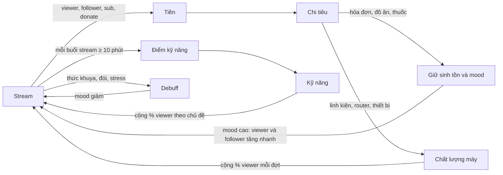
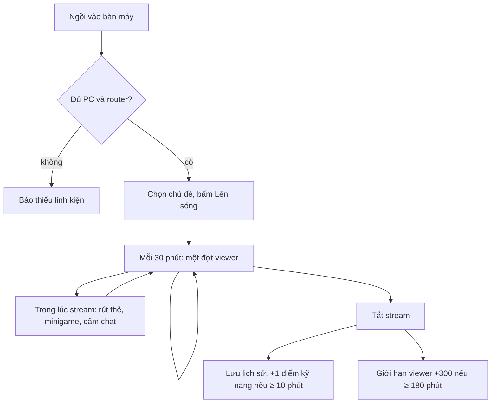
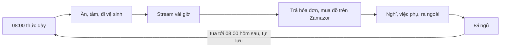

# Gameplay Loop

> Cập nhật: 2026-10-21 · Số liệu lấy từ code hiện tại trong `Assets/Scripts`

Người chơi là một streamer: **stream để kiếm tiền và follower → tiêu tiền để trả hóa đơn, ăn uống, nâng cấp máy và học kỹ năng → stream lần sau hiệu quả hơn**. Các nhu cầu sinh tồn và mood kéo hiệu quả stream xuống nếu bị bỏ bê, buộc người chơi phải chia thời gian giữa stream và chăm sóc bản thân.

## Vòng lặp tổng



Vòng lặp chạy ở ba nhịp:

| Nhịp | Thời gian trong game | Người chơi quyết định |
| --- | --- | --- |
| Buổi stream | Vài giờ | Chủ đề nào, rút thẻ nào, chơi minigame, cấm chat độc hại, khi nào tắt |
| Một ngày | 24 giờ | Stream bao lâu, lúc nào ăn, tắm, ngủ, trả hóa đơn, mua gì |
| Dài hạn | Nhiều ngày | Nâng cấp máy theo thứ tự nào, học kỹ năng nào, có thuê nhân viên hay đầu tư nguồn thu phụ |

**Tốc độ thời gian:** 5 phút trong game mỗi giây thực (`GameWorld.minutesPerRealSecond`). Như vậy 1 giờ trong game bằng 12 giây thực, một ngày bằng khoảng 4,8 phút thực. Pause (ESC) dừng hẳn đồng hồ.

## 1. Một buổi stream



**Mở stream** (`StreamSystem.Open`): viewer ban đầu = 5% follower (tối thiểu 1) + 1–5 người, không vượt giới hạn viewer.

**Mỗi đợt 30 phút** (`StreamSystem.RunWave`), lần lượt:

1. **Tăng viewer** theo phần trăm, nếu không có sự cố và chưa chạm giới hạn:
   ```
   % tăng = ngẫu nhiên 3–8 + hệ số mood + bonus kỹ năng + bonus thú cưng + bonus máy + bonus kênh nhỏ
   ```
   Bonus kênh nhỏ: dưới 100 viewer +10–14, dưới 200 +7–9, dưới 400 +5.
2. **Dao động viewer** lên hoặc xuống ngẫu nhiên 1–5% (khi đã trên 10 viewer).
3. **Follower mới** = viewer × tỷ lệ theo mood (4–15%), giảm dần ở kênh lớn (từ 10.000 follower trở lên).
4. **Sub mới** theo số viewer và mood, trần bằng 8% follower.
5. **Donate**: xác suất `min(90%, 55% + viewer / 500 × 20%)`, số tiền `1–5 × max(1, viewer / 50)`.

**Tắt stream** (`StreamSystem.Close`):
- Stream từ 10 phút trở lên: lưu vào lịch sử (app Youhube) và nhận 1 điểm kỹ năng.
- Stream từ 180 phút trở lên: giới hạn viewer tăng 300 (`200 + 300 × số ngày stream đủ dài`). Đây là đòn bẩy chính để kênh lớn lên.

**Hành động trong lúc stream:**

| Hành động | Tác động |
| --- | --- |
| Rút thẻ (F1) | Chọn 1 trong 3 thẻ. Thành công thì cộng % viewer; thẻ nào cũng đổi mood |
| Minigame (F2) | Theo chủ đề: Just Chatting (trả lời câu hỏi), ASMR (slider), Dance (bấm phím theo nhịp). Kết quả cộng % viewer |
| Cấm người xem | Giảm độ độc hại của chat |

## 2. Một ngày



**Khi qua ngày mới** (`GameWorld.OnDayPassed`): phát hóa đơn tiền nhà và tiền điện, sinh việc làm thêm qua thư, trả lương nhân viên, reset xổ số và vòng quay, rồi tự lưu game.

**Khi đi ngủ** (`GameWorld.SleepUntilMorning`): đóng stream nếu đang mở, tua đồng hồ tới 08:00, reset giờ thức, kiểm tra bị bệnh (từ ngày 3), rồi tự lưu.

### Nhu cầu sinh tồn

| Chỉ số | Tăng | Debuff khi vượt | Cách giải |
| --- | --- | --- | --- |
| Giờ thức | +1 mỗi giờ | > 12 giờ: mệt | Ngủ |
| Đói | +1 mỗi 2 giờ | > 6: đói | Ăn (tủ lạnh: đói −4, stress −5; hoặc đồ ăn trong kho) |
| Vệ sinh | +1 mỗi 2 giờ | > 6: cần đi vệ sinh | Toilet |
| Tắm | +1 mỗi 2 giờ | > 15: bốc mùi | Bồn tắm (stress −10) |
| Bệnh | Có thể bị sau khi ngủ, từ ngày 3 | Bệnh | Uống thuốc |

Xác suất bị bệnh sau mỗi lần ngủ:

```
(1 − (độ sạch nhà / 2 + mood / 200)) × 50%
```

Nhà sạch và mood cao giúp giảm nguy cơ bệnh.

### Mood

Mood từ 0 đến 100, bắt đầu ở 60. Cứ mỗi 5 giây thực (tức 25 phút trong game), **mỗi debuff đang bật trừ 0,5 mood**, và bị nghèo (dưới $200) trừ thêm 0,5.

Ảnh hưởng của mood lên stream:

| Mood | % viewer mỗi đợt | Tỷ lệ follower trên viewer | Lượt nhận sub |
| --- | --- | --- | --- |
| ≥ 80 | +2 | 12–15% | +2 |
| 50–79 | +1 | 10–15% | +1 |
| 25–49 | −1 (khi mức tăng gốc ≥ 3) | 7–13% | 0 |
| < 25 | −2 (khi mức tăng gốc ≥ 3) | 4–10% | −2 (khi có từ 3 lượt) |

Trạng thái hiển thị trên UI: Perfect ≥ 90, Happy ≥ 70, Calm ≥ 50, Standard ≥ 30, Demoralized ≥ 15, Depressed < 15.

## 3. Dài hạn

| Đòn bẩy | Cách tăng | Hiệu quả |
| --- | --- | --- |
| Giới hạn viewer | Mỗi ngày có buổi stream ≥ 180 phút | +300 viewer tối đa |
| Chất lượng máy | Mua linh kiện trên Zamazor, lắp vào case | FPS = 25 + chất lượng × 2,2. Bonus viewer = chất lượng stream / 12 (tối đa khoảng +8% mỗi đợt) |
| Chất lượng stream | Router (upload × 0,4, khoảng 2–15 điểm), webcam, mic, đèn | Cộng vào chất lượng stream (tối đa 100) |
| Kỹ năng | 1 điểm mỗi buổi stream được lưu | +1% viewer cho mỗi kỹ năng đã học; Ambitious +3%; kỹ năng đúng chủ đề (Chatter, Gaming, Tongue, Dance, Pool) +6% |
| Follower | Stream đều, mood cao | Viewer ban đầu mỗi buổi = 5% follower |
| Nguồn thu phụ | Đào coin, việc qua thư, cầm đồ, thuê nhân viên | Có tiền khi không stream |

**Kinh tế:**
- Bắt đầu với $500.
- Tiền nhà $50 mỗi ngày.
- Tiền điện $1,8/kWh, tính theo thiết bị đang chạy (stream 0,45 kW, rig đào coin thêm).
- Dưới $200 bị debuff nghèo.

## Vấn đề cần xử lý

Đây là những điểm phát hiện khi đối chiếu vòng lặp với code, ảnh hưởng trực tiếp tới cảm giác chơi:

| Vấn đề | Ảnh hưởng | Vị trí |
| --- | --- | --- |
| Ngủ không reset được mệt: khi tua giờ, giờ thức và đói vẫn bị cộng theo từng giờ | Ngủ dậy là bị mệt và đói ngay, phá nhịp một ngày | `Core/GameWorld.cs`, `SleepUntilMorning` |
| Thẻ thất bại không trừ viewer: chỉ áp dụng % khi > 0 | Rút thẻ gần như không có rủi ro, chỉ mất mood | `Streaming/Cards/StreamCardDeck.cs`, `Play` |
| Thời gian rất nhanh: 3 giờ stream chỉ mất 36 giây thực | Người chơi ít có thời gian tương tác trong buổi stream (thẻ, minigame, chat) | `GameWorld.minutesPerRealSecond` |
| Peak viewer không cập nhật sau đợt dao động | Lịch sử stream ghi peak thấp hơn thực tế | `Streaming/StreamSystem.cs`, `RunWave` |

## Tài liệu liên quan

- `Roadmap/README.md`: các giai đoạn phát triển.
- `CoreMechanics.md`: công thức của game gốc Streamer Life Simulator 2.
- `MechanicsChecklist.md`: checklist toàn bộ cơ chế.
- `UI_Flow.md`: các màn hình và luồng UI.
