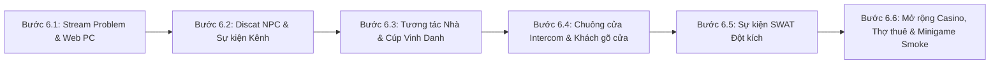

# Giai đoạn 6 — Đồng bộ đầy đủ tính năng từ bản gốc SLS2

> Cập nhật: 2026-10-21

Mục tiêu: bổ sung toàn bộ các tính năng, trang web, sự kiện ngẫu nhiên, tương tác trong nhà và hệ thống phụ có trong bản gốc `Streamer Life Simulator 2` (`SLS2`) mà dự án hiện chưa có hoặc mới chỉ có class khung chưa nối vào scene `Home.unity` / `DesktopOS.cs`.

---

## Thứ tự triển khai lần lượt (6 Bước)

---

## Bước 6.1 — Báo lỗi trực tiếp khi Stream & Các trang Web chức năng trên PC

| STT | Tính năng | Script gốc SLS2 | Script dự án (Tạo mới / Cập nhật) | Trạng thái |
| --- | --- | --- | --- | --- |
| 6.1.1 | **Cảnh báo lỗi trực tiếp khi đang Stream** (`problemBG`: chọn `Gaming` nhưng chưa mở game, thiếu `Microphone`, rớt khung hình `dropframe` do mạng yếu làm tụt người xem) | `StreamEventManager.cs` (`GameStreamProblemDetect`, `OpenProblem`) | `Assets/Scripts/Streaming/StreamSystem.cs`, `Assets/Scripts/Computer/DesktopOS.cs` | [x] Xong |
| 6.1.2 | **Trang web FastWeb Speedtest & Internet Boost** (đồng hồ kim đo Mbps Download/Upload thời gian thực + mua 4 gói kích tốc mạng theo từng nhà `Home 1..4`) | `FastWeb.cs`, `FastWebPackage.cs` | `Assets/Scripts/Social/BrowserApp.cs`, `Assets/Scripts/Computer/DesktopOS.cs`, `Assets/Scripts/Rig/Router.cs` | [x] Xong |
| 6.1.3 | **Trang web CryptoWeb** (sàn giao dịch mua/bán đồng BTC đào được theo tỷ giá biến động và xem danh sách máy đào đang chạy) | `CryptoWeb.cs`, `CryptoMiningManager.cs`, `DetectedMinerUI.cs` | `Assets/Scripts/Economy/CryptoMining.cs`, `Assets/Scripts/Computer/DesktopOS.cs` | [x] Xong |
| 6.1.4 | **Trang web LinkWorkerWeb** (thuê nhân viên làm việc từ xa và tự động gửi hóa đơn lương định kỳ mỗi 4 ngày) | `LinkWorkerWeb.cs`, `LinkWorkerUI.cs` | `Assets/Scripts/Economy/WorkerManager.cs`, `Assets/Scripts/UI/BillPanel.cs`, `Assets/Scripts/Computer/DesktopOS.cs` | [x] Xong |
| 6.1.5 | **Trang web FakeViewer & FeaturedStream** (mua bot tăng mắt xem ảo hoặc mua quảng cáo đẩy kênh lên trang chủ) | `FakeViewer.cs`, `FeaturedStream.cs` | `Assets/Scripts/Streaming/StreamSystem.cs`, `Assets/Scripts/Computer/DesktopOS.cs` | [x] Xong |
| 6.1.6 | **Trang web SlotWebGame & PogoWebsite** (chơi quay hũ có dòng thưởng trực tiếp trên trình duyệt web của máy tính) | `SlotWebGame.cs`, `SlotWebGameLine.cs`, `PogoWebsite.cs` | `Assets/Scripts/Computer/DesktopOS.cs` | [x] Xong |

---

## Bước 6.2 — Hệ thống Nhân vật Discat tương tác & Giới hạn Viewer đầu game

| STT | Tính năng | Script gốc SLS2 | Script dự án (Tạo mới / Cập nhật) | Trạng thái |
| --- | --- | --- | --- | --- |
| 6.2.1 | **Kịch bản Felix Tutorial trên Discat** (hướng dẫn mở đầu và gửi nhiệm vụ qua tin nhắn Discat) | `DiscatTutorialManager.cs` | `Assets/Scripts/Social/DiscatApp.cs`, `Assets/Scripts/Computer/DesktopOS.cs` | [x] Xong |
| 6.2.2 | **5 Nhân vật tương tác trên Discat** (`BitMan`, `BotMan`, `FanMan`, `HackerMan`, `HaterMan` — chọn câu trả lời, nhận link lừa đảo nhiễm virus, mua bán ngầm, nhận quà) | `DiscatBitManManager.cs`, `DiscatBotManManager.cs`, `DiscatFanManManager.cs`, `DiscatHackerManManager.cs`, `DiscatHaterManManager.cs` | `Assets/Scripts/Social/DiscatApp.cs`, `Assets/Scripts/Computer/DesktopOS.cs` | [x] Xong |
| 6.2.3 | **Giới hạn người xem 7 ngày đầu (`ViewerLimitation`) & Khung thông báo Sub mới (`subInfoBorder`)** | `StreamEventManager.cs` | `Assets/Scripts/Streaming/StreamSystem.cs`, `Assets/Scripts/Computer/DesktopOS.cs` | [x] Xong |

---

## Bước 6.3 — Tương tác trong nhà: Công tắc đèn RGB, Rương đồ, Gương soi & Cúp Vinh Danh

| STT | Tính năng | Script gốc SLS2 | Script dự án (Tạo mới / Cập nhật) | Trạng thái |
| --- | --- | --- | --- | --- |
| 6.3.1 | **Công tắc đèn & Đổi màu đèn phòng RGB (`LightSwitch` / `Lamp`)** (bật/tắt đèn trong nhà và chuyển đổi bảng màu ánh sáng phòng stream) | `LightSwitch.cs`, `Lamp.cs` | `Assets/Scripts/World/LightSwitch.cs`, `Assets/Scripts/Editor/Phase1SceneBuilder.cs` | [x] Xong |
| 6.3.2 | **Rương chứa đồ trong nhà (`ChestInventory`)** (cất giữ và lấy lại các vật phẩm, linh kiện PC chưa dùng tới) | `ChestInventory.cs` | `Assets/Scripts/Items/ChestInventory.cs`, `Assets/Scripts/Editor/Phase1SceneBuilder.cs` | [x] Xong |
| 6.3.3 | **Gương soi nhân vật (`MirrorCamera`)** (phản chiếu ngoại hình nhân vật trong phòng tắm/phòng ngủ) | `MirrorCamera.cs` | `Assets/Scripts/World/MirrorSurface.cs`, `Assets/Scripts/Editor/Phase1SceneBuilder.cs` | [x] Xong |
| 6.3.4 | **Cúp Vinh Danh Streamer (`CreatorAward`) & Hộp quà sự kiện (`GiftBox` / `FrogGiftPainting`)** (mở hộp quà nhận nút Play khắc tên kênh và tranh treo tường) | `CreatorAward.cs`, `GiftBox.cs`, `FrogGiftPainting.cs`, `PrizeManager.cs` | `Assets/Scripts/Items/CreatorAward.cs`, `Assets/Scripts/Items/GiftBox.cs` | [x] Xong |

---

## Bước 6.4 — Chuông cửa Intercom & Hệ thống Khách gõ cửa theo cốt truyện

| STT | Tính năng | Script gốc SLS2 | Script dự án (Tạo mới / Cập nhật) | Trạng thái |
| --- | --- | --- | --- | --- |
| 6.4.1 | **Màn hình Camera Chuông cửa (`DoorIntercom`)** (đổ chuông cửa, bật màn hình nhỏ cạnh cửa xem camera ngoài hiên và nhấn nút mở khóa cửa) | `DoorIntercom.cs` | `Assets/Scripts/World/DoorIntercom.cs`, `Assets/Scripts/World/Door.cs` | [x] Xong |
| 6.4.2 | **Khách gõ cửa theo chuỗi sự kiện (`DoorCharactersManager` & `DoorAI`)** (`Frog`, `Lover Mimi`, `Police`, `Hermit Streamer`, `BigBoy`, `FanBoy` đứng trước cửa nói chuyện và đưa lựa chọn) | `DoorCharactersManager.cs`, `DoorAI.cs`, `TalkFrogPanel.cs`, `TalkPolicePanel.cs`, `TalkHermitPanel.cs`, `TalkLoverMimiPanel.cs`, `TalkBigBoyPanel.cs`, `TalkFanBoyPanel.cs` | `Assets/Scripts/Npc/DoorCharactersManager.cs`, `Assets/Scripts/Dialogue/DialogueSystem.cs` | [x] Xong |

---

## Bước 6.5 — Sự kiện SWAT Đột kích (`SwatManager`)

| STT | Tính năng | Script gốc SLS2 | Script dự án (Tạo mới / Cập nhật) | Trạng thái |
| --- | --- | --- | --- | --- |
| 6.5.1 | **Đội đặc nhiệm SWAT phá cửa & Ném Flashbang** (tiếng đập cửa, tung cửa, lựu đạn choáng làm trắng màn hình + tiếng ù tai, 2 đặc nhiệm SWAT ập vào, khóa điều khiển và đưa người chơi ra ngoài đường) | `SwatManager.cs`, `Swat.cs`, `SwatCamera.cs` | `Assets/Scripts/World/SwatManager.cs`, `Assets/Scripts/UI/ScreenFader.cs`, `Assets/Scripts/Social/DiscatApp.cs` | [x] Xong |

---

## Bước 6.6 — Hoàn thiện tích hợp Casino, Thợ thuê & Minigame trong `Smoke`

| STT | Tính năng | Script gốc SLS2 | Script dự án (Tạo mới / Cập nhật) | Trạng thái |
| --- | --- | --- | --- | --- |
| 6.6.1 | **Đặt đầy đủ quầy trò chơi may rủi vào Scene** (`ScratchCard` vé cào, `Raffle` xổ số, `SkinCase` mở hòm skin, `GtuLottery` máy gạt GTU) | `ScratchManager.cs`, `RaffleManager.cs`, `SkinCase.cs`, `GTU.cs` | `Assets/Scripts/Casino/`, `Assets/Scripts/Editor/Phase1SceneBuilder.cs` | [ ] Một phần (Đã có script, chưa đặt đủ vào Scene) |
| 6.6.2 | **NPC Thợ sơn tường (`PainterWorker`) & Nhân viên cày Stream (`StreamerWorker` / `TableCanvas`)** hoạt động trực quan trong nhà | `PainterWorker.cs`, `StreamerWorker.cs`, `TableCanvas.cs` | `Assets/Scripts/Home/WallPainter.cs`, `Assets/Scripts/Economy/StreamWorker.cs`, `Assets/Scripts/Editor/Phase1SceneBuilder.cs` | [ ] Một phần (Đã có logic, chưa có NPC/bàn phụ trong Scene) |
| 6.6.3 | **Tích hợp mở và chơi trực tiếp `CamperStrike`, `PogoGame`, `BrainRotClicker` ngay từ thư viện `Smoke` trên PC** (kèm bảng hạ gục `KillerInfoPanel`, súng và bậc rank) | `CamperStrikeManager.cs`, `KillerInfoPanel.cs`, `PogoCheckpoint.cs`, `BrainRotClicker.cs` | `Assets/Scripts/Minigames/`, `Assets/Scripts/Computer/DesktopOS.cs` | [ ] Một phần (Đã có script minigame, cần nối trực tiếp vào nút Play của `Smoke`) |

---

## Tiêu chí hoàn thành Giai đoạn 6

- [ ] Toàn bộ 6 bước (6.1 → 6.6) đều hoạt động trực tiếp trong scene `Home.unity` và trên màn hình 3D `DesktopOS`.
- [ ] Không phát sinh lỗi biên dịch hoặc lỗi Runtime trong Console khi kiểm thử từng bước.
