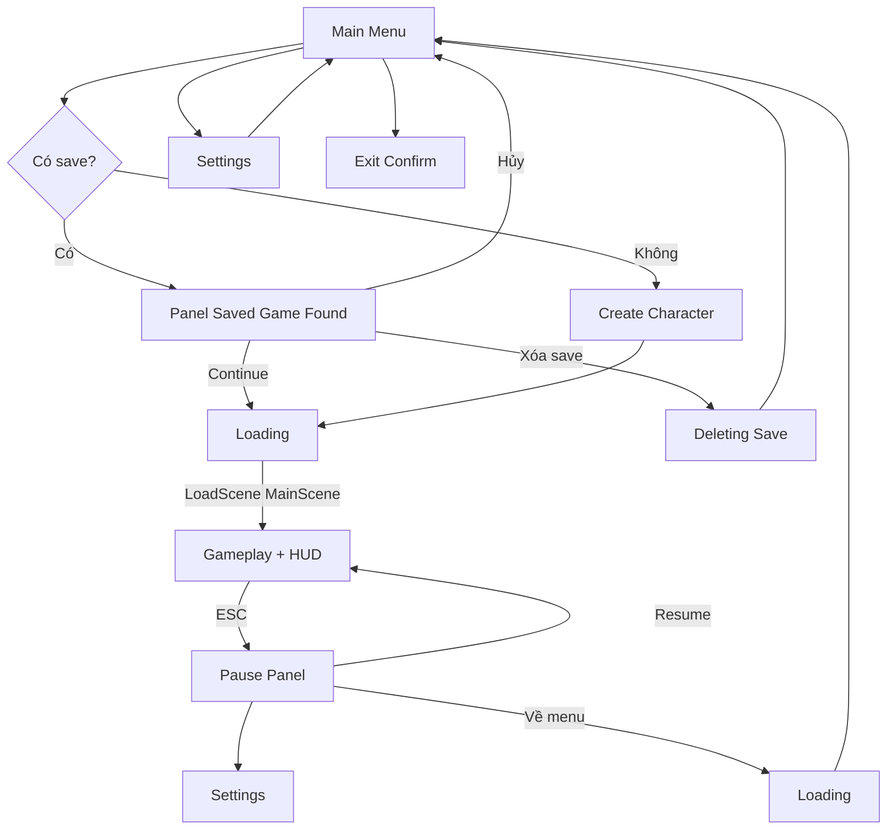
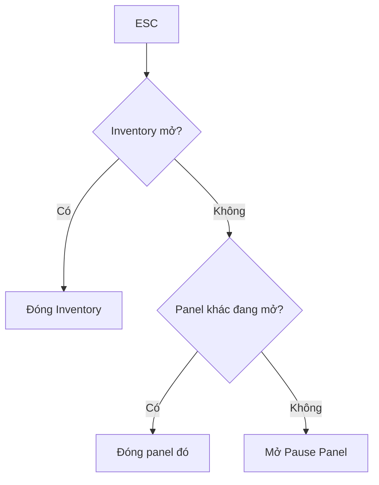
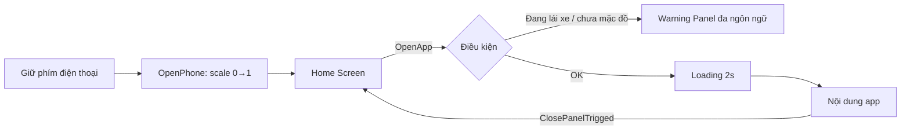
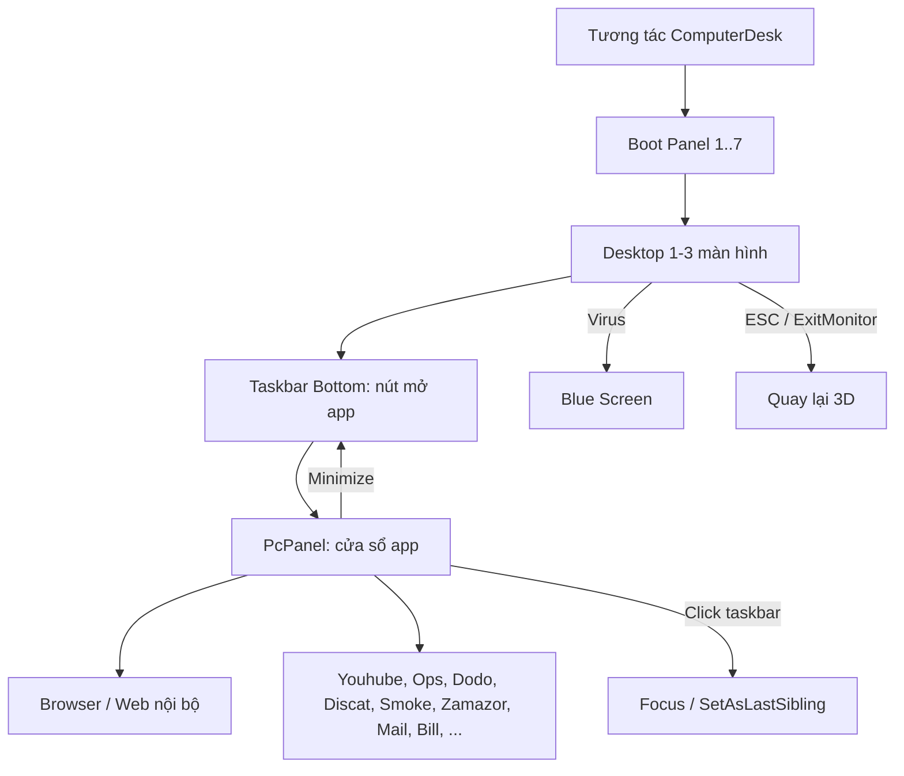

# Streamer Life Simulator 2 — Các loại UI và luồng chạy

> Cập nhật: 2026-10-20

## Tổng quan

Game có 10 nhóm UI, tất cả xoay quanh `UIManager` (HUD + phím ESC), `PhoneManager` (điện thoại) và `GlobalComputerCanvas` (máy tính giả lập). Nguồn phân tích là thư mục Assembly-CSharp decompile của Streamer Life Simulator 2, khoảng 1.024 file `.cs`.

- **Code game (thư mục gốc):** `GameManager`, `SaveManager`, `UIManager`, `StreamEventManager`, `ChatMessageManager`, `PhoneManager`, `CryptoMiningManager`, `PetManager`, `DayNightManager`, các `Talk*Panel`, minigame `BlackjackManager`, `DanceGame`, `SlotMachineClub`.
- **Asset bên thứ ba:** Easy Save 3 (`ES3Types`, lưu game), Vuplex (trình duyệt web trong game), FIMSpace (ragdoll, animation), Michsky UI, EFPController, TMPro, OmniVehicleAi.

Giới hạn: danh sách suy ra từ code (`UIManager`, `MenuManager`, `PhoneManager`, `GlobalComputerCanvas`, `PausePanel`, `SettingsMenu`). Chưa mở prefab hay scene, nên tên nút con hoặc app cụ thể trong prefab có thể còn thiếu.

## Các nhóm UI

| Nhóm                         | Thành phần                                                                                                                                                                                                                                                                                                                                         | Script chính                                                                                                                              |
| ----------------------------- | ---------------------------------------------------------------------------------------------------------------------------------------------------------------------------------------------------------------------------------------------------------------------------------------------------------------------------------------------------- | ------------------------------------------------------------------------------------------------------------------------------------------ |
| Main Menu (scene MainMenu)    | Màn hình chính, tạo nhân vật, "tìm thấy save" (Continue / Xóa save / Hủy), tiến trình xóa save, xác nhận thoát, Settings                                                                                                                                                                                                             | `MenuManager`, `CustomizeCharacter`                                                                                                    |
| HUD trong game                | Crosshair, tên item, gợi ý tương tác (3 slot phím + chữ), gợi ý Build / Rotate / Cancel / Drop / Sweep / Clean / Eat / Use / Bike / Car / Focus / ExitMonitor, icon item, badge số mail và hóa đơn chưa đọc, Warning Panel (giữa màn hình), Bottom Info (dòng thông báo xanh/đỏ), hộp báo skill point, Fader / Flashbang | `UIManager`                                                                                                                              |
| Panel toàn màn hình        | Pause, Map (phím M), Inventory (I / Tab), Settings, Controls                                                                                                                                                                                                                                                                                        | `PausePanel`, `MapPanel`, `Inventory`, `SettingsMenu`, `ControlsPanel`                                                           |
| Điện thoại                 | Màn hình Home và các app: Eat / Food delivery, Clothes, Pet, Car, Camera, Album, Skill, Map                                                                                                                                                                                                                                                      | `PhoneManager`, `PhoneAppsPanel`, `EatApps`, `ClothApps`, `PetAppsPanel`, `CameraApps`, `AlbumAppsPanel`, `SkillAppsPanel` |
| Máy tính (desktop giả)     | Desktop 1–3 màn hình, màn hình boot, taskbar, cửa sổ PcPanel (kéo, thu nhỏ, phóng to), Blue Screen, thông tin phần cứng                                                                                                                                                                                                                 | `GlobalComputerCanvas`, `PcPanel`, `Bottom` / `BottomPanel`, `BootingPanel`, `ComputersPanel`                                  |
| App trên PC                  | Browser (WebView Vuplex), Web nội bộ (WebPanel + WebContentPanel), Youhube, Ops, Dodo, Discat (chat), Smoke (kiểu Steam), Zamazor (mua sắm), Mail, Bill, Fakegram, Spoti, GTU, VirusScanner, CryptoWeb, BBSWindow, SlotWebGame, JustChatting, StreamerTools, StreamWorker                                                                        | Trùng tên với class                                                                                                                     |
| Stream overlay                | Chat, TopStreamInfo, Donate, SoundDonate, InfoBar                                                                                                                                                                                                                                                                                                    | `ChatPanel`, `TopStreamInfoPanel`, `SoundDonatePanel`, `GlobalCanvasInfoBar`                                                       |
| Panel tương tác thế giới | Build case, Rig case, Wall Paint, Stream Interact (chọn worker), Sleep / Save / Shower / Toilet, Hairdresser / Cloth camera, bảng pawn, barber                                                                                                                                                                                                     | `UIManager`, `BarberShop`, `PawnShop`                                                                                                |
| Hội thoại NPC               | River, Hobo, Mimi, LoverMimi, Fr, FanBoy, CrispyJerry                                                                                                                                                                                                                                                                                                | `Talk*Panel`                                                                                                                             |
| Minigame UI                   | Blackjack, Slot, Dance, Raffle, Scratch, LuckySpin, BrainRot, Asmr, Pogo, CamperStrike                                                                                                                                                                                                                                                               | Các `*Manager` / `*Game`                                                                                                              |

## Luồng Main Menu đến Gameplay

Có save thì người chơi chọn Continue, Xóa save hoặc Hủy; chưa có save thì vào Create Character. Từ Pause, "Về menu" đi qua một màn Loading khác để quay lại Main Menu.

## Phím ESC và phím tắt

ESC được xử lý trong `UIManager.Update` theo thứ tự ưu tiên: nó đóng panel đang mở trước, và chỉ mở Pause khi không còn panel nào đang mở.

1. Inventory đang mở → đóng Inventory.
2. Các panel khác đang mở → đóng panel đó (thứ tự chi tiết cần đọc lại `UIManager.Update`).
3. Không có panel nào mở → mở Pause Panel.

| Phím       | Hành động                                       |
| ----------- | -------------------------------------------------- |
| M           | Bật / tắt Map                                    |
| I hoặc Tab | Bật / tắt Inventory                              |
| ESC         | Đóng panel hoặc mở Pause (theo thứ tự trên) |

Khi mở một UI, game gọi `playerMotor.SetFreezed(true)` để khóa nhân vật và `InputManager.ShowCursor(true)` để hiện con trỏ. Khi bật Pause, `BrowserManager.GamePaused()` tạm dừng JavaScript của trình duyệt Vuplex.

## Luồng điện thoại

Mở app luôn qua bước kiểm tra điều kiện: đang lái xe hoặc chưa mặc đồ thì hiện Warning Panel, ngược lại chờ Loading 2 giây rồi vào app. Đóng app (`ClosePanelTrigged`) quay về Home.

## Luồng máy tính

Mỗi app PC là một cửa sổ `PcPanel` mở từ taskbar; thu nhỏ thì về taskbar, click taskbar thì đưa cửa sổ lên trên cùng. Nhiễm virus dẫn tới Blue Screen; ESC hoặc ExitMonitor đưa người chơi về thế giới 3D.

## Ghi chú và hướng đào sâu

Các luồng trên dựng từ code; chưa đối chiếu với prefab hoặc scene. Các hướng có thể đào sâu tiếp:

- [ ] Chi tiết từng app điện thoại (Eat, Clothes, Pet, Car, Camera, Album, Skill, Map)
- [ ] Chi tiết các cửa sổ PC (Youhube, Discat, Zamazor, Mail, Bill, …)
- [ ] Luồng stream / donate / chat (`StreamEventManager`, `ChatMessageManager`, `SoundDonatePanel`)
- [ ] Thứ tự đầy đủ các panel trong nhánh ESC của `UIManager.Update`
