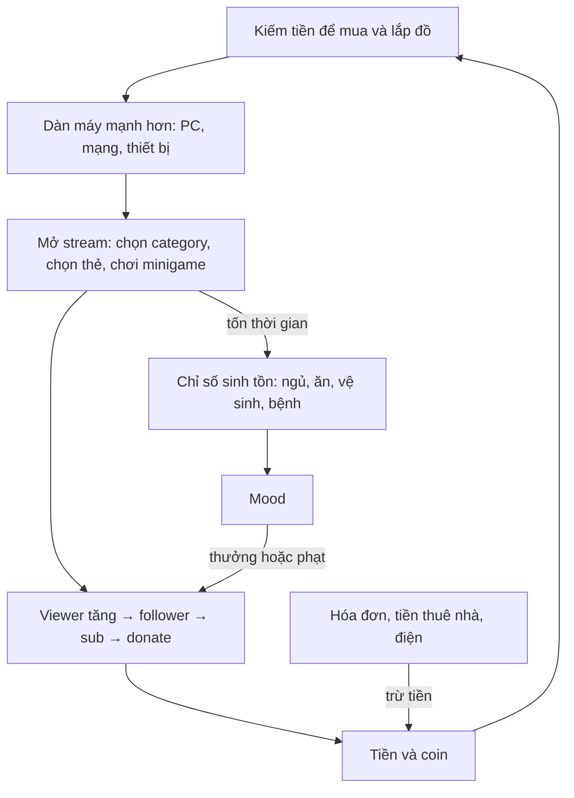

# Streamer Life Simulator 2 — Core mechanic và các hệ thống game

> Cập nhật: 2026-10-20

## Tổng quan

`StreamerLifeSim2_Features.md` liệt kê chức năng theo màn hình và script. Tài liệu này mô tả **cơ chế** (đầu vào, đầu ra, công thức) và **cách các hệ thống nối với nhau**, đủ để thiết kế lại hoặc dựng lại.

Nguồn: đọc trực tiếp `StreamEventManager`, `GameManager`, `MoodController`, `Ops`, `SkillManager` trong `Assembly-CSharp`. Các con số bên dưới là giá trị trong code. Phần chưa đọc được ghi rõ ở mục "Chưa phân tích".

## Core loop

Vòng lặp: kiếm tiền → nâng cấp dàn máy → stream được lâu và ổn định hơn → viewer và sub tăng → kiếm nhiều tiền hơn. Mood là cơ chế giữ người chơi không stream mãi: bỏ bê nhu cầu cơ bản thì mood giảm và mọi chỉ số tăng trưởng giảm theo.

## 1. Thời gian trong game

| Cơ chế | Chi tiết |
| --- | --- |
| Đồng hồ | `hour`, `minute`, `day`. Phút tăng theo `timeCounter`, nhân 1,5 trong một số trường hợp (trong `GameManager` quanh dòng 362) |
| Sự kiện mỗi giờ | `OneHourPassed`: giá Bitcoin đổi, đếm điện, `awekingTime++`; mỗi 2 giờ thì `notShowerTime`, `toiletTime`, `hungerTime` tăng 1 và sinh lao công |
| Sự kiện mỗi ngày | Sinh hóa đơn (tiền thuê nhà), ngủ, trả lương nhân viên, đổi giá, bài Fakegram mới, sự kiện thư/việc, rút thăm, giải thưởng, GTU |
| Ngủ | `PlayerSleepNow`: reset `awekingTime`, cộng `hungerTime` và `toiletTime` thêm 6 |
| Nguy cơ bệnh | Từ ngày 3 trở đi, sau khi ngủ 30–40 giây thì có kiểm tra bệnh (xem mục 3) |
| Virus | Từ ngày 2, vào các giờ chia hết cho 7 thì kiểm tra `CheckBlueScreenVirus` |

## 2. Hệ thống stream (core mechanic chính)

### Trạng thái

`GameManager`: `currentViewer`, `totalFollowers`, `totalSubs`, `partner`, `totalToxicity`. `Ops`: `streamOpen`, `streamHour`, `streamHasDrop`, category đang chọn (`justchatting`, `gaming`, `asmr`, `dancing`, `pooling`).

### Vòng đời

| Bước | Hành vi |
| --- | --- |
| Mở stream (`StreamOpened`) | Reset các bộ đếm trễ, sinh nhóm viewer đầu tiên (`SetFirstViewer`), tính hệ số thú cưng (`petManager.Calculate`), đưa stress âm về 0 |
| Đang stream | Mỗi 30 phút có đợt viewer mới (`Minutes30PassedOnStream`), nếu stream không rớt (`streamHasDrop`), không có sự cố và chưa chạm giới hạn viewer |
| Đóng stream (`StreamClosed`) | Viewer về 0, đóng mọi minigame. Nếu đã stream từ 3 giờ trở lên thì `viewerLimitationDay++` |
| Lưu lịch sử | Stream từ 1 giờ hoặc 10 phút trở lên thì sinh mục trong `Youhube` (tên, thời lượng, chất lượng) |

### Viewer

| Cơ chế | Quy tắc |
| --- | --- |
| Dao động (`ViewerWave`) | Chỉ khi viewer > 10; mỗi lần cộng hoặc trừ ngẫu nhiên một tỷ lệ: 2,5–5% (dưới 2.000), 2–3% (2.000–3.999), 1–1,5% (từ 4.000) |
| Tăng theo phần trăm (`UpdateViewerPercent`) | Bị bỏ qua nếu có sự cố stream hoặc đã chạm giới hạn viewer. Cộng thêm điểm phần trăm cho kênh nhỏ: dưới 100 viewer +10–14, dưới 200 +7–9, dưới 400 +5 |
| Hệ số mood | Mood ≥ 80: +2; ≥ 50: +1; ≥ 25: −1 (nếu phần trăm ≥ 3); dưới 25: −2 (nếu phần trăm ≥ 3) |
| Hệ số kỹ năng | `pickMeSkill` +1; kỹ năng theo category: Chatter (just chatting), Gaming, Tongue (ASMR), Dance, Pool, mỗi cái +1 khi đúng category |
| Giới hạn viewer | `ViewerLimitation` phụ thuộc `viewerLimitationDay`: tăng sau mỗi ngày stream đủ 3 giờ trở lên |
| Sự cố | `GameStreamProblemDetect`: khi có sự cố (lag, hỏng máy, virus) thì viewer không tăng |

### Follower

`EarnFollower`: số follower mới = viewer × tỷ lệ theo mood (≥ 80: 12–15%; ≥ 50: 10–15%; > 25: 7–13%; còn lại 4–10%). Giảm dần ở các mốc lớn (≥ 10.000 nhân 0,75; ≥ 50.000 nhân 0,5; ≥ 100.000 nhân 0,25). Tối thiểu 1–2 người, +1 với 25% xác suất khi dưới 500 follower, 50% xác suất được cộng thêm 25–70%. Từ 3.000 follower trở lên có xác suất bị ép về 1–2 (70% ở 3.000–6.000, giảm dần còn 40% từ 50.000 trở lên). Trần 99.999.999.

### Sub

`SubsEarnRoutine` chạy theo vòng. Số vòng phụ thuộc viewer (từ 1–1 khi dưới 50 viewer đến 3–9 khi từ 40.000 viewer trở lên), mood ≥ 80 cộng 2 vòng, ≥ 50 cộng 1, dưới 25 trừ 2 (khi số vòng ≥ 3). Mỗi vòng cộng số sub theo bậc follower (1 khi dưới 1.000 follower, đến 100–149 khi từ 1.000.000 follower trở lên). Trần: sub vượt 8% tổng follower (`MySubsInLimit`) thì 50% cộng 1–2, 50% trừ 1–2. Khi chưa chạm trần, nếu sub lớn thì có xác suất mất sub (sub > 500: 30% mất 2–4 sub; > 200: 20%; > 100: 15%). Khoảng chờ giữa hai đợt sub dài dần theo số sub vừa nhận (2–9 giây khi nhận ít, đến 40–50 giây khi nhận hơn 90).

### Thẻ hành động khi stream

`StreamEventManager.ShowCardsRoutine` hiện các thẻ (`CardScript`) theo chu kỳ `cardShowDelay`. Người chơi chọn thẻ trong `SelectedCard` (khoảng 1.300 dòng xử lý), mỗi thẻ có xác suất thành công/thất bại, thưởng hoặc phạt viewer, donate, mood. Ví dụ thẻ `card1`: 30% thành công, ra donate kèm tin nhắn đa ngôn ngữ.

### Minigame trong stream

Just Chatting (trả lời đúng/sai), ASMR, Dance, Pool, Game. Mỗi cái có panel riêng, đóng khi tắt stream.

### Donate và chat

| Cơ chế | Chi tiết |
| --- | --- |
| Chat tự sinh | Tốc độ phụ thuộc số viewer (`SetChatDelay`), tên người xem lấy từ `ChatMessageManager.GetNicknames` |
| Donate | `SpawnDonate`: tiền, âm thanh (`SoundDonate`) và overlay |
| Toxic | Người xem độc hại làm `totalToxicity` tăng, có cơ chế cấm người xem (`ToxicUserBanned`) |

## 3. Sinh tồn và mood

### Nhu cầu cơ bản

| Nhu cầu | Biến | Tăng khi | Ngưỡng báo debuff |
| --- | --- | --- | --- |
| Thức khuya | `awekingTime` | +1 mỗi giờ; reset khi ngủ | > 12 giờ (kỹ năng Zombie: > 16) |
| Đói | `hungerTime` | +1 mỗi 2 giờ, +6 khi ngủ | Có `hungerInfo` và `debuffHunger` (ngưỡng đọc trong `MoodController`) |
| Vệ sinh | `toiletTime` | +1 mỗi 2 giờ, +6 khi ngủ | `debuffToilet` |
| Tắm | `notShowerTime` | +1 mỗi 2 giờ | > 15 |
| Bệnh | `playerGetSick` | Xem bên dưới | `debuffSick` |
| Nghèo | `money` | — | < 200 |
| Stress | `PlayerMotor.stress` | Ăn đồ có `stress`, hành động; `LoseOrGainStress` giới hạn 0–100 | > 90 bật hiệu ứng hạt |

Kiểm tra debuff mỗi 5 giây (`CheckFiveSecondDebuffs`). Mỗi debuff có icon nhỏ, banner lớn và ảnh hưởng đến mood.

### Mood

`MoodController.mood` giới hạn 0–100, đổi qua `ChangeMood(giá trị)`. Các mức trạng thái: depressed, demoralized, standard, calm, happy, perfect. Mood tác động tới: số vòng sub, tỷ lệ follower, phần trăm tăng viewer, và xác suất bị bệnh.

### Bệnh

`MaybePlayerGetSick` (từ ngày 3): xác suất bệnh = `1 − (độ sạch nhà / 2 + mood / 200)`, giới hạn 0–1, sau đó nhân thêm 50% ngẫu nhiên. Nhà càng bẩn và mood càng thấp thì càng dễ bệnh. Thuốc (`Medicines`) chữa bệnh, giá đổi theo ngày.

## 4. Kinh tế

| Dòng tiền | Nguồn / chỗ tiêu |
| --- | --- |
| Thu | Donate khi stream, bán đồ ở tiệm cầm đồ, việc phụ (`MailJobManager`: nhận tiền theo thời gian và nội dung), đào Bitcoin (`CryptoMiningManager`, giá đổi mỗi giờ) |
| Chi | Tiền thuê nhà và hóa đơn mỗi ngày (`BillPanel`), điện cho thiết bị (`UpdateElectricWorkingCount`), mua đồ trên Zamazor, đồ ăn, thuốc, quần áo, xe, lương nhân viên (`CheckWorkerPayment`) |
| Tiền tệ | `money` (float) và `ownedBitcoin` (float) |
| Rủi ro | Hết tiền → debuff "poor" (< 200); hacker/hater/virus lấy tiền hoặc làm hỏng máy (xem mục 7) |

## 5. Dàn máy và nâng cấp

| Cơ chế | Chi tiết |
| --- | --- |
| Slot PC | Mainboard, CPU, tản nhiệt, RAM ×4, GPU ×2, PSU, HDD, CD-ROM (`PcCase`) |
| Chất lượng | Mỗi `ItemObject` có `quality` và `gb`. `caseQuality` quyết định FPS máy (`GetComputerFPS`) |
| Liên kết với stream | Chất lượng và mạng ảnh hưởng chất lượng stream (`saveStreamQualitySlider`) và sự cố stream |
| Mạng | Router và `downloadSpeed`/`uploadSpeed` |
| Đào coin | Rig case + Bit Miner, `currentMiningPower`, giá coin đổi theo giờ |
| Điện | Thiết bị tốn điện, tính vào hóa đơn |
| Sao | `StarEnum`: 0,5 đến 5 sao cho độ hiếm/chất lượng |

## 6. Kỹ năng

22 kỹ năng (`SkillApp`), mua bằng `currentSkillPoint`:

| Nhóm | Kỹ năng |
| --- | --- |
| Sinh tồn | Sleeper, Zombie (ngưỡng tỉnh táo 16 giờ), Satiated, Energetic, SweetDream |
| Kinh tế | Thrifty, PartTime, CryptoExpert, Sponsored, Donate, Donator, Boss |
| Stream | PickMe (+1 viewer%), Ambitious, Youhuber |
| Category | Chatter (just chatting), Gaming, Tongue (ASMR), TheWhip, Dance, Pool |
| Khác | PetLover |

Điểm kỹ năng nhận khi đạt mốc tiến trình (thông báo qua `NewSkillPointEanerdInfoBox`).

## 7. Sự kiện ngẫu nhiên và rủi ro

| Sự kiện | Cơ chế |
| --- | --- |
| Blue Screen / virus | Kiểm tra mỗi 7 giờ từ ngày 2; `VirusScannerApp` giúp phòng |
| Hater, hacker, bot, fan | Các manager `Discat*` có `DailyCheck` |
| Sự cố stream | Lag, hỏng máy: viewer không tăng cho tới khi sửa |
| Bệnh | Xem mục 3 |
| Toxic user | Tăng độc hại, cần cấm |
| Rút thăm, giải thưởng, GTU | Reset mỗi ngày |
| NPC | Shipper, cảnh sát/SWAT, lao công tự sinh |

## 8. Thế giới và tương tác

| Cơ chế | Chi tiết |
| --- | --- |
| Tương tác | Raycast từ người chơi, hiện gợi ý phím (3 slot) và tên vật phẩm |
| Cầm, đặt, thả | Cầm vật phẩm (`currentHandItem`), chế độ build có vùng đặt hợp lệ (`buildAreas`), xoay theo trục cho phép (`rotateX/Y/Z`), snap |
| Mua và vận chuyển | Mua online → shipper giao thùng (`CargoBox`) → nhận tại cửa (`CourierEnum`) |
| Di chuyển | Đi bộ, xe hơi, xe máy, xe đạp; điện thoại bị khóa khi lái xe |
| Nhà | Thuê/mua nhiều nhà; ra/vào đổi UI và ánh sáng |
| NPC | Hội thoại theo panel, nhiệm vụ nhỏ và quà tặng |
| Thú cưng | Hoang → nuôi → đi theo → cầm tay; có hệ số ảnh hưởng stream (`petManager.Calculate`) |

## 9. Tiến trình và thành tích

| Cơ chế | Chi tiết |
| --- | --- |
| Hướng dẫn | `TutorialManager` theo chặng (`tutorialCount`, `Tutorial4Quest1Completed`) |
| Mốc | Partner, 1.000 sub, 100.000 follower có thành tích Steam (`NEW_ACHIEVEMENT_1_16/17/18`) |
| Đa ngôn ngữ | 11 ngôn ngữ, dịch bằng bảng và DeepL/GPT cho nội dung động |
| Lưu | Easy Save 3, lưu `notShowerTime`, `toiletTime`, `playerGetSick`, `hungerTime`, mood… |

## Chưa phân tích

Các phần sau tôi chưa đọc chi tiết nên chưa mô tả công thức:

- Nội dung từng thẻ stream (hơn 1.300 dòng `SelectedCard`) và mô-đun `ShowCardsRoutine`.
- Công thức donate, tiền thưởng mỗi giờ stream, `Ops` (giá cước, chất lượng stream).
- Công thức đào Bitcoin, biến động giá, tốc độ hư hỏng/điện của linh kiện.
- Hệ thống nhân viên stream (`StreamerWorker`) và `WorkerManager`.
- Chi tiết minigame: Blackjack, Slot, Dance, ASMR, CamperStrike, Pogo.
- Hệ thống nhiệm vụ NPC.

Nếu cần, tôi sẽ đọc từng phần và bổ sung vào file này.

## Tài liệu liên quan

- `StreamerLifeSim2_Features.md`: chức năng theo hệ thống và script.
- `StreamerLifeSim2_UI_Flow.md`: các loại UI và luồng chạy.
- `StreamerLifeSim2_Models.md`: danh sách model 3D.
- `StreamerLifeSim2_Packages.md`: danh sách package.
